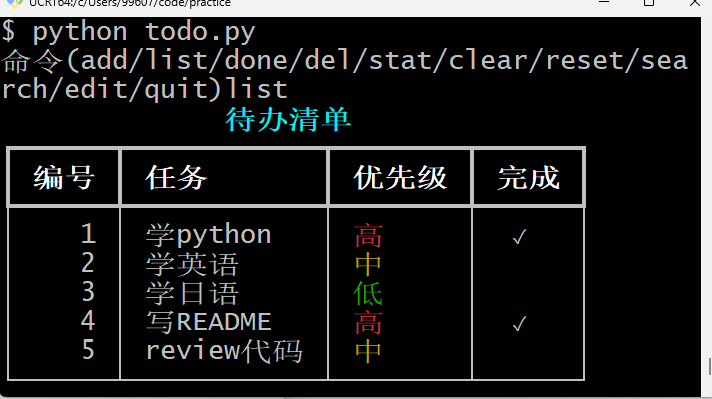

# 待办清单 Todo CLI

一个跑在终端里的待办事项管理工具。数据存在本地 JSON 文件里，重启不丢；界面用 rich 渲染成彩色表格。

这是我学 Python 一个多月后写的第一个完整项目。



---

## 功能

| 命令 | 作用 |
|---|---|
| `add` | 添加一条待办，可选优先级（高/中/低，直接回车默认「中」） |
| `list` | 以表格形式列出全部待办（颜色区分优先级，已完成打勾） |
| `done` | 把第 N 条标记为已完成 |
| `del` | 删除第 N 条 |
| `edit` | 修改第 N 条的内容 |
| `search` | 按关键词搜索任务（子串匹配） |
| `stat` | 统计总数 / 已完成 / 未完成 |
| `clear` | 清空所有已完成的条目 |
| `reset` | 清空全部（需要二次确认） |
| `quit` | 退出 |

---

## 快速开始

需要 Python 3.10+（开发环境是 3.12）。

```bash
git clone https://github.com/zbw-developer/practice.git
cd practice

# 建虚拟环境并装依赖
python -m venv .venv
source .venv/Scripts/activate     # Windows Git Bash
# PowerShell: .venv\Scripts\Activate.ps1
# macOS/Linux: source .venv/bin/activate

python -m pip install -r requirements.txt

python todo.py
```

---

## 用法示例

```
命令(add/list/done/del/stat/clear/reset/search/edit/quit)add
需要添加什么:学英语
优先级(高/中/低,直接回车=中):高
已添加:学英语

命令(...)done
要标记第几条?1
已完成: 学英语

命令(...)list
        待办清单
┏━━━━━━┳━━━━━━━━┳━━━━━━━━┳━━━━━━┓
┃ 编号 ┃ 任务   ┃ 优先级 ┃ 完成 ┃
┡━━━━━━╇━━━━━━━━╇━━━━━━━━╇━━━━━━┩
│    1 │ 学英语 │ 高     │  ✓   │
│    2 │ 学数学 │ 中     │      │
│    3 │ 学日语 │ 低     │      │
└──────┴────────┴────────┴──────┘
```

---

## 技术点

- **JSON 持久化**：`json.dump` / `json.load` 读写 `todos.json`，每次改动立即存盘
- **向后兼容**：读取优先级用 `item.get("priority", "中")`，老数据没有这个字段也不会 `KeyError`
- **异常处理**：`todos.json` 被改坏时 `except json.JSONDecodeError` 兜底，不让程序崩在启动阶段
- **不边遍历边删**：`clear` 采用「建新列表只装保留项」的写法，避免遍历时修改列表导致的跳元素问题
- **输入校验**：`isdigit()` + `0 <= index < len(todos)` 链式比较，挡住非法编号
- **视觉呈现**：rich 的 `Table` 渲染四列表格，`[red]`/`[yellow]`/`[green]` 标记区分优先级
- **环境隔离**：`.venv` + `requirements.txt`，`.venv/` 与数据文件写进 `.gitignore`

---

## 项目结构

```
practice/
├── todo.py             # 主程序（唯一入口）
├── todos.json          # 数据（自动生成，不进 Git）
├── requirements.txt    # 依赖
├── screenshot.png      # 运行截图
├── 日志.md             # 学习日志
├── .gitignore
├── learning/           # 学习期间的练习脚本（与主程序无关）
│   ├── lesson1-8.py    # 语法练习：input / 条件 / 循环 / 函数 / 列表
│   ├── game.py         # 猜数字（函数版）
│   ├── dict1.py        # 字典练习
│   ├── temp.py         # 摄氏华氏互转
│   ├── save_test.py    # JSON 写入实验
│   ├── load_test.py    # JSON 读取实验
│   ├── rich_test.py    # rich 彩色表格实验
│   └── debug_test.py   # 断点调试练习
└── .venv/              # 虚拟环境（不进 Git）
```

---

## 踩过的坑（保留给自己看）

1. `open("FILE", ...)` —— 变量名加引号就变成了字符串字面量，文件永远找不到
2. `json.dump` 与 `json.load` 方向反了：dump 是写出去，load 是读进来
3. `"w"` 模式在 `open` 那一刻就清空原文件，不是写入时才清
4. 不写 `encoding="utf-8"`，Windows 默认 GBK，中文会变成 `ѧ�ֵ�`
5. `total = total + 1` 加错变量，统计永远是 0
6. 建了 `Table` 却忘了 `add_row`，表格打印出来是空的
7. 复制 `done` 的代码改 `edit`，忘了改提示语

---

## 待办（下一步）

- [ ] 按优先级排序 / 只显示未完成
- [ ] 截止日期（`datetime`）
- [ ] 导出为 Markdown 清单
- [ ] 单元测试（`pytest`）
